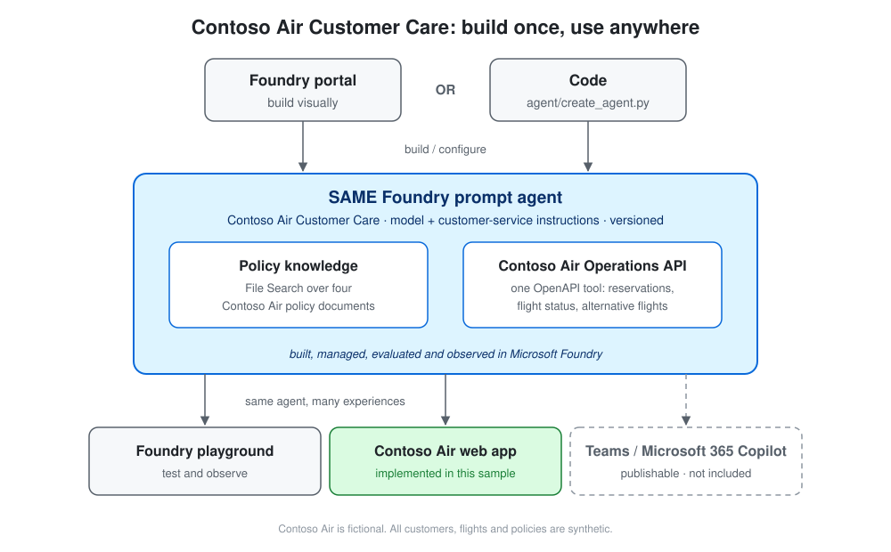
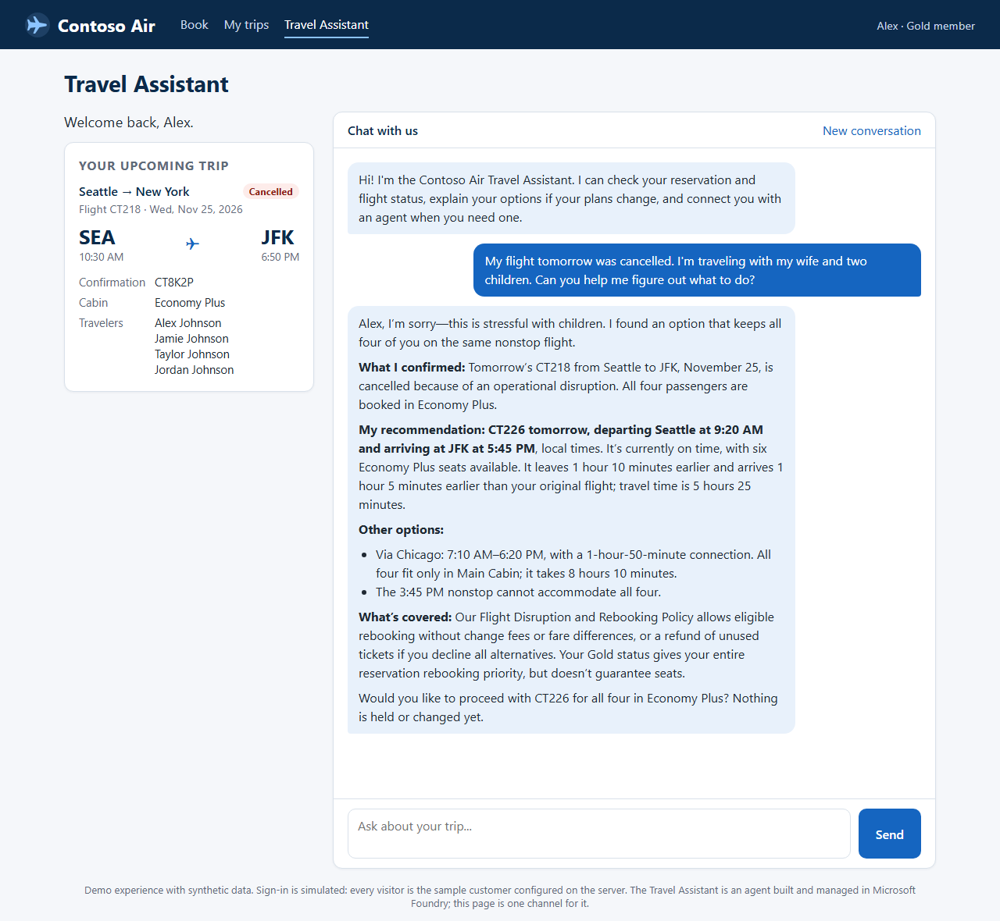

# Contoso Air Customer Care Agent

A customer-service **prompt agent** built in Microsoft Foundry that helps a traveler recover from a cancelled
flight. It combines customer and reservation data, current operational data and company policy with its own
reasoning to recommend what to do next.

**Build visually or with code → the same Foundry agent → enterprise knowledge + business tools → evaluate and
observe → use it in the experiences where users work**

You can build the agent **visually in the Foundry portal** or **with code**. Either way you get the same agent.
You can then use that one agent from the Foundry playground, from the included Contoso Air web app and, by
publishing it, from other experiences.



> **About this sample.** Contoso Air is a fictional airline. All customers, reservations, flights and policies
> are synthetic. This sample is for demonstration only. Sign-in in the included web app is simulated, and the
> sample does not connect to any real airline reservation system.

## Two demos: voice first, text as the fallback

**The same grounded business capabilities can power different user experiences — including real-time voice.**

| | Demo | Where | Status |
| --- | --- | --- | --- |
| **Primary** | **Demo 1B: Voice.** Alex *calls* Contoso Air and talks to a Foundry voice-based prompt agent, interrupting it naturally | [voice/](voice/README.md) | Validated; present this one |
| **Fallback / reference** | **Demo 1A: Text.** The same scenario as a text agent in the Foundry playground and the Contoso Air web app | this README | Validated; kept ready if audio, browser or voice service problems occur |

Both demos reuse the same **synthetic airline data**, **company policies** (`knowledge/`) and **Operations API**
(`tools/`). Each has its own Foundry agent definition, optimized for its interaction mode: concise, spoken,
interruptible turns for voice; richer formatted answers for text. Present one demo, not both. Demo 1A is not
deprecated; it's the recovery path, and the rest of this README describes it.

To present the voice demo, start with [voice/README.md](voice/README.md) and the
[voice demo script](voice/demo/demo-script.md).

## What you'll build

- **The Foundry agent owns the reasoning.** It decides which tools to call, applies policy, weighs alternatives
  and recommends a next step.
- **Policy knowledge.** Four Contoso Air policy documents are available to the agent through File Search.
- **The Operations API returns facts only.** This single OpenAPI tool exposes three read-only operations:
  - `get_customer_reservations`
  - `get_flight_status`
  - `search_alternative_flights`

  It returns reservations, flight status, and alternative itineraries with seat availability by cabin. It does
  not rank, recommend or apply policy.
- **The web app is a channel.** It relays the conversation to the agent and shows friendly progress messages.
  It contains no customer-service logic.

See [demo/architecture.md](demo/architecture.md) for the detailed diagram, responsibilities and request flow.

## See the scenario

Alex Johnson is a Contoso Air **Gold** member. Alex is flying Seattle (SEA) → New York (JFK) tomorrow on
**CT218**, on reservation `CT8K2P`, with three other family members. All four are booked in **Economy Plus**.
CT218 has been **cancelled**.

Alex asks:

> My flight tomorrow was cancelled. I'm traveling with my wife and two children. Can you help me figure out what to do?

The agent:

1. Looks up Alex's reservation and finds four travelers in Economy Plus.
2. Confirms from operational data that CT218 is cancelled.
3. Checks the rebooking, loyalty and assistance policies.
4. Searches for alternatives and weighs each one on party size, cabin, nonstop versus connecting, times and
   operational status:
   - **CT226**: nonstop, enough Economy Plus seats for all four, but departs earlier.
   - **CT232**: nonstop, but only three seats.
   - **CT310 + CT442**: a connection through Chicago; all four together only in Main Cabin.
5. Recommends **CT226**, explains the tradeoffs and asks for confirmation. It never claims to have rebooked
   anything, because no booking tool exists.

The recommendation is not hard-coded anywhere. It comes from data, policy and the agent's reasoning.



## Set up

### Prerequisites

- An Azure subscription with a **Microsoft Foundry project** and a chat model deployment.
- The **Foundry User** role (formerly *Azure AI User*) on the project, for the signed-in user.
- [Azure CLI](https://learn.microsoft.com/cli/azure/install-azure-cli), signed in with `az login`.
- Python 3.10 or later. Node.js is optional; one frontend syntax test uses it.

### Prepare the repository

From the `contoso-air-customer-care` folder, run the setup script. It checks the prerequisites, creates `.venv`,
installs the packages, creates `.env` from `.env.example` and validates your configuration:

```powershell
# Windows PowerShell
.\scripts\setup.ps1
```

```bash
# macOS / Linux
./scripts/setup.sh
```

The first run creates `.env` and stops so you can fill it in. It is git-ignored; never commit real values.

| Variable | Purpose |
| --- | --- |
| `FOUNDRY_PROJECT_ENDPOINT` | Project endpoint from the project's Overview page |
| `FOUNDRY_MODEL_DEPLOYMENT_NAME` | Model deployment the agent uses |
| `FOUNDRY_AGENT_NAME` | Agent name (default `contoso-air-customer-care`) |
| `FOUNDRY_AGENT_VERSION` | Optional: pin the agent version clients use (see [Agent versions](#agent-versions)) |
| `TOOLS_API_BASE_URL` | Public HTTPS URL of the Operations API |
| `DEMO_CUSTOMER_ID` | Simulated signed-in customer for the web app (default `CUST-1007`) |
| `WEBAPP_TURN_TIMEOUT_SECONDS` | Optional: how long the web app waits for one agent turn (default 180) |

Run the setup script again after editing `.env`.

The script creates `.venv` but can't activate it in your terminal. Before running any `python ...` command in this
README, activate it once per terminal session:

```powershell
.\.venv\Scripts\Activate.ps1     # Windows PowerShell
```

```bash
source .venv/bin/activate        # macOS / Linux
```

If PowerShell blocks the script, run `Set-ExecutionPolicy -Scope Process Bypass` first, or call
`.\.venv\Scripts\python.exe` directly instead of `python`.

<details>
<summary>Manual setup without the script</summary>

```powershell
# Windows PowerShell
python -m venv .venv
.\.venv\Scripts\Activate.ps1
pip install -r requirements.txt
Copy-Item .env.example .env      # then edit .env
az login
```

```bash
# macOS / Linux
python -m venv .venv
source .venv/bin/activate
pip install -r requirements.txt
cp .env.example .env             # then edit .env
az login
```

</details>

### Deploy the Operations API

Foundry calls OpenAPI tools from the cloud, so the mock API needs a public HTTPS endpoint. This script deploys
it to Azure Container Apps (no local Docker needed) and writes `TOOLS_API_BASE_URL` to `.env`:

```powershell
python scripts/deploy_tools.py --resource-group <your-resource-group> --location westus3 --update-env
```

To explore the API locally, see [tools/README.md](tools/README.md).

## Build the agent

Choose either option. Both produce an equivalent agent from the same instructions, knowledge and tool.

### Option A — Build visually in Foundry

Follow [docs/foundry-ui-agent-setup.md](docs/foundry-ui-agent-setup.md). In the Foundry portal you:

1. Create a prompt agent named `contoso-air-customer-care` and choose your model.
2. Paste in [agent/instructions.md](agent/instructions.md).
3. Add the four policy PDFs in [knowledge/](knowledge/) with **File Search**.
4. Add the **Contoso Air Operations API** as a single OpenAPI tool. The spec is served at
   `<TOOLS_API_BASE_URL>/openapi.json`.
5. Test the hero prompt in the playground.

### Option B — Build with code

[agent/create_agent.py](agent/create_agent.py) uses the current Foundry SDK (`azure-ai-projects` 2.x). It creates
the same agent from the same files: the instructions, the four policy PDFs in a File Search vector store, and
the Operations API OpenAPI tool.

```powershell
python agent/create_agent.py --dry-run   # print the definition; no Azure calls
python agent/create_agent.py             # create a new agent version and make it active
python agent/create_agent.py --test      # ...and send the hero prompt to it
```

Each run creates a new agent version. The script records it as the active version in `.foundry-state.json`,
which is git-ignored.

The [Portal ↔ code equivalence](docs/foundry-ui-agent-setup.md#portal--code-equivalence) table maps each portal
setting to the code.

### Agent versions

Foundry versions every saved agent definition. No version is hard-coded. The web app and the evaluation runner
use:

1. `FOUNDRY_AGENT_VERSION`, if set.
2. Otherwise, the `activeAgentVersion` that `create_agent.py` recorded.
3. Otherwise, the agent's latest version. For example, the version you last saved in the portal.

## Use the same agent everywhere

### In the Foundry playground

Open the agent in the Foundry portal and ask the hero prompt. Good follow-ups:

- *Why is that better than the connection?*
- *Do I qualify for a hotel?*
- *Book it.* The agent explains that it can't make the change in chat. It tells you how to complete the change
  and confirms nothing has been booked or held.

The Operations API rebases all dates to the current day, so CT218 is always cancelled "tomorrow."

### In the Contoso Air web app

[webapp/](webapp/README.md) is a lightweight Contoso Air "Travel Assistant" page. It talks to the **same** Foundry
agent through the Responses API:

```powershell
python -m uvicorn server:app --app-dir webapp/backend --port 8080
```

Open <http://localhost:8080> and click the suggested question. The page:

- Shows Alex's upcoming trip and its flight status. This is display-only data from the Operations API.
- Passes the signed-in customer to the agent as application context. Sign-in is simulated, and the chat cannot
  change the customer.
- Shows progress such as *Checking your trip…*, *Checking flight status…* and *Reviewing your options…*. It never
  shows tool names or internal data.
- Keeps one Foundry conversation per chat, so follow-up questions keep their context.

### In other experiences

A Foundry agent is a reusable asset. Because the reasoning lives in the agent, other channels don't have to
reimplement it. You can publish the agent to experiences such as **Microsoft Teams** and **Microsoft 365
Copilot**, where it uses the same instructions, knowledge and tools. These channels are **not implemented** in
this sample.

## Evaluate the agent

Deterministic tests run offline and don't need Azure:

```powershell
python -m pytest
python data/generate_data.py --check    # validate the synthetic data
python knowledge/build_pdfs.py --check  # validate the policy PDFs
```

Live scenario evaluations run against your agent:

```powershell
python evaluation/run_evaluation.py --no-judge   # deterministic checks only
python evaluation/run_evaluation.py              # plus an LLM judge
python evaluation/run_evaluation.py --cloud      # optional: also submit a Foundry cloud evaluation
python scripts/validate_webapp.py                # the web app end to end against the live agent
```

[evaluation/test_cases.json](evaluation/test_cases.json) covers:

- the hero path;
- alternatives that can't seat the whole family;
- policy questions;
- unknown reservations and flights;
- tool failures;
- conflicting information;
- "Book it" requests.

Each case checks which tools the agent called and what it said. For example, it must recommend CT226 and must
not claim a completed booking. The LLM-judge and cloud evaluation steps are optional.

## Run the demo

**Present the voice demo (Demo 1B).** Its presenter package is in [voice/demo/](voice/demo/): the
[demo script](voice/demo/demo-script.md), [setup checklist](voice/demo/setup-checklist.md),
[troubleshooting](voice/demo/troubleshooting.md) and [validation record](voice/demo/validation-record.md).

```powershell
python voice/scripts/validate_voice_demo.py   # ends with VOICE DEMO READY; --live adds one scripted voice call
```

Keep Demo 1A ready as the fallback. The [demo/](demo/) folder is its presenter package:

| File | Use it for |
| --- | --- |
| [demo-script.md](demo/demo-script.md) | The timed walkthrough, talking points, cut order and Q&A |
| [setup-checklist.md](demo/setup-checklist.md) | What to prepare before presenting |
| [troubleshooting.md](demo/troubleshooting.md) | Symptoms, causes and fixes for common problems |
| [fallback-transcript.md](demo/fallback-transcript.md) | A recorded run to use if the live demo is unavailable |
| [architecture.md](demo/architecture.md) | The architecture visual and technical details |

Before presenting:

```powershell
python scripts/validate_demo.py --hero   # readiness check plus one live hero turn; ends with DEMO READY
python scripts/reset_demo.py             # clear local caches between runs; changes nothing in Azure or Foundry
```

### Scripts

| Script | What it does |
| --- | --- |
| `scripts/setup.ps1`, `scripts/setup.sh` | Check prerequisites, install packages, create `.env` and validate it |
| `scripts/deploy_tools.py` | Deploy the Operations API to Azure Container Apps |
| `scripts/validate_demo.py` | Readiness check. `--hero` adds a live hero turn; `--comprehensive` also runs the tests and evaluations |
| `scripts/validate_webapp.py` | End-to-end web app checks against the live agent |
| `scripts/reset_demo.py` | Reset local demo state. `--clear-results` also removes evaluation results |
| `scripts/cleanup.ps1`, `scripts/cleanup.sh` | Remove local files and, after confirmation, the Azure resources |

## Repository layout

| Folder | What it contains |
| --- | --- |
| `agent/` | Instructions, shared configuration, and `create_agent.py` |
| `knowledge/` | Policy sources (`source/*.md`, the source of truth) and the generated PDFs |
| `data/` | Deterministic synthetic customers, reservations, flights and status |
| `tools/` | Contoso Air Operations API (FastAPI) and its OpenAPI specification |
| `webapp/` | Sample web channel (FastAPI relay + static frontend) |
| `evaluation/` | Scenario test cases and the evaluation runner |
| `scripts/` | Setup, deployment, validation, reset and cleanup |
| `demo/` | Presenter package, architecture and screenshots |
| `voice/` | Demo 1B: the voice agent, its evaluation scenarios, tests and presenter package |
| `docs/` | Foundry portal setup guide and the implementation specification |
| `tests/` | Offline unit tests |

## Clean up

The cleanup scripts remove local files by default. Azure resources are deleted only when you ask, and only after
you type each resource's name to confirm:

```powershell
.\scripts\cleanup.ps1                                  # local caches, deployment staging, evaluation results
.\scripts\cleanup.ps1 -IncludeVenv -IncludeLocalState  # also .venv, .env and .foundry-state.json
.\scripts\cleanup.ps1 -Azure                           # also the Operations API Container App
.\scripts\cleanup.ps1 -Azure -DeleteResourceGroup      # also the whole resource group
.\scripts\cleanup.ps1 -Azure -DeleteResourceGroup -DryRun   # preview without deleting anything
```

On macOS or Linux, use `./scripts/cleanup.sh` with `--include-venv`, `--include-local-state`, `--azure`,
`--delete-resource-group` and `--dry-run`.

Remove the Foundry resources in the portal. The script prints these steps:

1. **Agent**: delete `contoso-air-customer-care` (all versions) under **Agents**.
2. **Knowledge**: delete the `contoso-air-policies` vector store and its four uploaded files in the project's
   **Data** / **Files** pages.

This sample does not create the Foundry project or the model deployment, so keep or remove them as you prefer.
