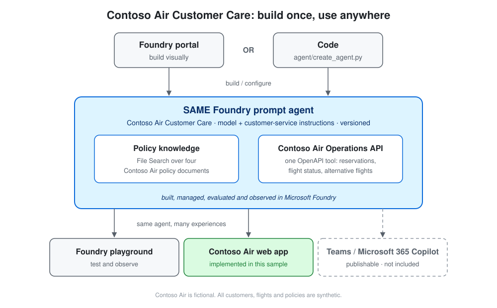
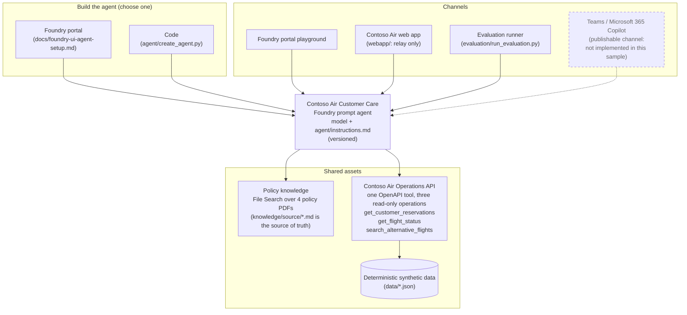

# Architecture

**Build once, use anywhere.** One Microsoft Foundry prompt agent holds the customer-service reasoning.
You can build it visually in the Foundry portal or with code. Every channel then reuses that same agent.



In one line: **portal or code → the same Foundry prompt agent → policy knowledge + Operations API → many experiences.**
For slides, use [`assets/architecture.png`](assets/architecture.png).

## Detailed view



Text version:

```text
   Foundry portal (UI)          agent/create_agent.py (code)
              \                         /
               ▼                       ▼
        ┌───────────────────────────────────────────┐
        │  Contoso Air Customer Care (prompt agent) │  same instructions, model,
        │  versioned; clients use the active version│  knowledge and tool either way
        └───────────────┬───────────────┬───────────┘
                        │               │
          File Search (policy PDFs)   OpenAPI tool: Contoso Air Operations API
                                        (reservations · flight status · alternatives)
                                                     │
                                              synthetic data
                        ▲               ▲               ▲                 ▲
                        │               │               │                 ┆
              Portal playground    Web app (relay)   Evaluations   Teams / M365 Copilot
                                                                   (not implemented)
```

## Responsibilities

| Component | Owns | Does not own |
| --- | --- | --- |
| Foundry prompt agent | Understanding the request; deciding which tools to call; applying policy; weighing alternatives (party size, cabin, nonstop vs connection, times, status); the recommendation and its tradeoffs; asking for confirmation | Inventing data or policy; claiming actions it cannot take |
| Policy knowledge | Rebooking, loyalty, meal/hotel and escalation rules | Customer or flight data |
| Operations API | Factual, read-only records: reservations, flight status, alternative itineraries with cabin-level seat availability (chronological order) | Ranking, recommendations, eligibility, policy, booking |
| Web app | Simulated sign-in (demo only); trip card for display; relaying chat to the agent; friendly progress and error messages | Any customer-service, policy, ranking or loyalty logic |
| Evaluation runner | Running scripted conversations and checking the agent's behavior | Changing the agent's behavior |

## Agent versions

Foundry keeps every saved definition of the agent as a numbered version. Version numbers are never hard-coded.
Clients resolve the version in this order:

1. `FOUNDRY_AGENT_VERSION` (in `.env`), if set.
2. `activeAgentVersion` in `.foundry-state.json`, written by `agent/create_agent.py` (git-ignored).
3. Otherwise, the agent's latest version. For example, this is the version you last saved in the portal.

The web app logs the version it resolved for each session and reports it at `/api/health`.

## Request flow (web app)

1. The browser loads `/api/session`. The backend uses the demo sign-in (`DEMO_CUSTOMER_ID`), resolves the agent
   version and creates a Foundry conversation. The signed-in customer ID goes into a developer message as
   application context. The customer cannot type or override it.
2. Each chat message goes to `responses.create(..., stream=True)` with an `agent_reference` (name and version) on
   that same conversation. Follow-up questions therefore keep their context.
3. Tool-call stream events become friendly progress messages: *Checking your trip…*, *Checking flight status…*,
   *Checking Contoso Air policies…*, *Finding alternative flights…*, *Reviewing your options…*. Tool names,
   arguments, outputs and reasoning never reach the browser.
4. The agent's answer streams back to the browser. Errors become a friendly message with a short reference. The
   details are logged on the server only.

## Other channels

Foundry agents can be published to other experiences, such as Microsoft Teams and Microsoft 365 Copilot. Every
channel would reuse the same agent, knowledge and tools, so the reasoning does not have to be rebuilt per channel.
These integrations are **not implemented** in this sample.
