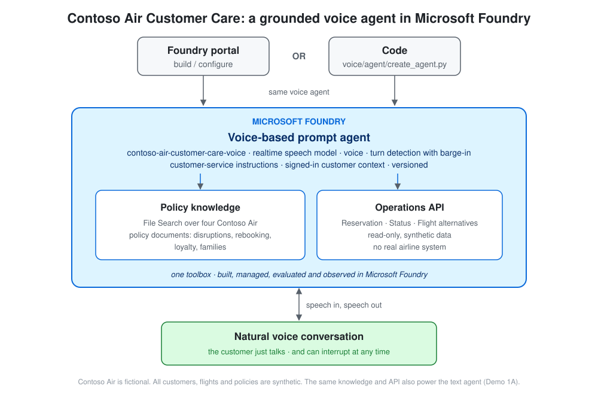

# Demo 1B: Contoso Air Customer Care voice agent

This folder contains a separate **Microsoft Foundry voice-based prompt agent**, `contoso-air-customer-care-voice`, for the same cancelled-flight scenario as Demo 1A.
- The caller speaks naturally.
- The agent replies in speech, and the caller can interrupt it at any time.
- The agent reasons over the same policies, synthetic data and Operations API as the text agent.

**The same grounded business capabilities can power different user experiences — including real-time voice.**

> **Status: primary Customer Service demo.** Version 11 is validated for presentation: see the [validation record](demo/validation-record.md). Demo 1A, the text agent and its web app, is the validated **fallback**; it's described in the [main README](../README.md).

> **About this sample.** Contoso Air is a fictional airline. All customers, reservations, flights and policies are synthetic, and no real airline system is connected. Caller authentication is **simulated**: the session is opened for the demo customer as if by a signed-in app.



```text
 Caller speech ──► Foundry voice agent (kind "voice", managed gpt-realtime-2.1)
                     │  voice-native instructions (voice/agent/instructions.md)
                     │  customer_id structured input (trusted session identity)
                     └─ one toolbox ─┬─ OpenAPI: Contoso Air Operations API (shared tools/, unchanged)
                                     └─ File Search: Contoso Air policies (shared vector store from Demo 1A)
```

## What is shared and what is new

| Asset | Location | Voice use |
|---|---|---|
| Policies | `knowledge/` | Reused through Demo 1A's existing vector store. The voice code never re-uploads or copies them. |
| Synthetic data | `data/` | Reused unchanged |
| Operations API | `tools/` (`tools/openapi.json`) | Reused unchanged. It returns facts only. |
| Text agent, web app, evaluations, demo | `agent/`, `webapp/`, `evaluation/`, `demo/` | **Frozen**. The voice code only reads Demo 1A helpers and `.foundry-state.json`, and never writes them. |
| Voice agent | `voice/agent/` | New: voice-native instructions, config, creation code and a live session harness |
| Voice checks | `voice/evaluation/`, `voice/tests/` | New: spoken scenarios and offline tests |

The voice agent owns all customer-service reasoning: policy interpretation, choosing among alternatives, and tradeoffs. Neither the API nor the harness ranks flights or applies policy.

## Platform facts this design depends on

These were confirmed against current Microsoft Learn documentation and the `azure-ai-projects` 2.11 SDK.
- **Voice agents** are agents with `kind: "voice"`, created with `project.agents.create_version(...)` using a `VoiceAgentDefinition`. Every create produces a new immutable version.
- **Voice agents accept only `function`, `mcp`, `toolbox` and `system` tools.**
  - OpenAPI and File Search cannot be attached directly.
  - They are packaged together in a single **toolbox** (`project.toolboxes.create_version`), and the agent pins that toolbox's version.
  - An agent can have one toolbox *or* individual tools, not both.
- **Identity** is a `structured_inputs` entry (`customer_id`).
  - The instructions refer to it as `{{customer_id}}`.
  - The client supplies it when it opens the session.
  - It is rendered once per session, and nothing the caller says can change it.
  - Authentication is **simulated** in this demo: the harness passes `CUST-1007` (Alex Johnson) as if it came from a signed-in app.
- **Model:** managed `gpt-realtime-2.1`, a native speech-to-speech model that needs no deployment. In the project's East US Foundry resource, the managed models that worked were:
  - `gpt-realtime-2.1`
  - `gpt-realtime-2.1-mini`
  - `gpt-realtime-1.5`

  Other names (`gpt-realtime`, `gpt-realtime-mini`, `azure-realtime`) returned "not supported in this region". Availability varies by region, so check your own resource.
- **Version pinning:** a session connects to the agent by name. The harness pins the version with `extra_query={"agent_version_override": "<n>"}`.

### Toolbox OpenAPI quirk (handled in code)

Toolbox OpenAPI tools validate API **responses** as strict JSON Schema. Two problems follow:
- The OpenAPI 3.0 `nullable: true` keyword is ignored. A documented `null` fails validation, for example a child passenger's `loyaltyNumber`.
- The toolbox's 3.0 validator also rejects JSON Schema type arrays.

`voice_common.toolbox_compatible_spec()` therefore sends the toolbox a **copy** of `tools/openapi.json`:
- declared as OpenAPI **3.1.0**;
- with `nullable: true` rewritten as `type: [T, "null"]`.

The shared 3.0.3 spec is not modified, and the text agent is unaffected.

## Prerequisites

1. **Demo 1A setup is complete.**
   - `.env` has `FOUNDRY_PROJECT_ENDPOINT` and `TOOLS_API_BASE_URL`.
   - The Operations API is deployed.
   - `python agent/create_agent.py` has created the policy vector store (recorded in `.foundry-state.json`).

   See the [root README](../README.md).
2. **A Foundry project in a region with voice agents**, where your resource has a managed realtime model. See the model note above.
3. **Signed in with `az login`**, with the **Foundry User** role on the project. The harness also uses Microsoft Entra ID to synthesize caller speech with the project's Foundry resource, so no keys are needed.
4. **Voice dependencies installed** in the same virtual environment. From `contoso-air-customer-care`:

   ```powershell
   .\.venv\Scripts\Activate.ps1
   pip install -r voice/requirements.txt
   ```

   On macOS or Linux, activate with `source .venv/bin/activate`. This installs `azure-ai-projects[voice]` and `azure-cognitiveservices-speech`.

### Optional environment overrides (`.env`)

Nothing environment-specific is committed. All of these are optional.

| Variable | Default | Purpose |
|---|---|---|
| `FOUNDRY_VOICE_AGENT_NAME` | `contoso-air-customer-care-voice` | Voice agent name |
| `FOUNDRY_VOICE_MODEL` | `gpt-realtime-2.1` | Managed model name, or a deployment name when the type is `self_deployed` |
| `FOUNDRY_VOICE_MODEL_TYPE` | `managed` | `managed` or `self_deployed` |
| `FOUNDRY_VOICE_AGENT_VERSION` | active version in `voice/.voice-state.json` | Pins the version used by `run_session.py` |
| `FOUNDRY_VECTOR_STORE_ID` | `vectorStoreId` in `.foundry-state.json` | Shared policy vector store |
| `DEMO_CUSTOMER_ID` | `CUST-1007` | Client-side default identity for the harness (each scenario sets its own) |

The `defaultValue` of `customer_id` in `config.example.json` is only this **client-side** default. By default, the agent definition declares `customer_id` as required, with no default. A session opened without a trusted identity therefore fails, instead of quietly becoming Alex.

**Portal playground exception.** The Foundry portal playground's **Start session** sends no structured inputs. Against a strict version it shows "Failed to connect to the voice agent", because the service rejects the WebSocket with HTTP 400. For portal testing, publish a demo-only version with `--portal-default` (below). That version makes `customer_id` optional, with a default of `CUST-1007`, so a portal session starts as the seeded demo customer. The harness and `live_mic.py` still send `customer_id` explicitly, so their behavior is the same on either kind of version. Don't use `--portal-default` anywhere real authentication matters.

## Build it with code

Run these commands from `contoso-air-customer-care`, with the virtual environment active. In PowerShell, set `$env:PYTHONIOENCODING="utf-8"` first.

```powershell
python voice/agent/create_agent.py --dry-run        # print the toolbox + agent definitions; no Azure calls
python voice/agent/create_agent.py                  # new toolbox version + new voice agent version
python voice/agent/create_agent.py --reuse-toolbox  # new agent version on the current toolbox version
python voice/agent/create_agent.py --reuse-toolbox --portal-default  # demo-only: portal playground can start sessions
```

How versions are tracked:
- Foundry assigns the version numbers.
- The script records them in `voice/.voice-state.json` (git-ignored) and makes the new version active, unless you pass `--no-activate`.
- No version number is hard-coded anywhere.

To customize behavior without touching the defaults, copy `voice/agent/config.example.json` to `voice/agent/config.json` (git-ignored). It covers the voice, turn detection, phrase list, interim responses and greeting.

## Build it in the Foundry portal

The portal path produces the same agent as the code path: same instructions, toolbox, model and identity input.

> **Note:** These steps follow current Microsoft Learn guidance ([quickstart](https://learn.microsoft.com/azure/foundry/agents/quickstarts/prompt-voice-agent), [configure a voice agent](https://learn.microsoft.com/azure/foundry/agents/how-to/configure-voice-agent), [toolbox](https://learn.microsoft.com/azure/foundry/agents/how-to/tools/toolbox)). In Phase V1 the agent was built and tested with code. In Phase V2 the portal playground was used for a live call on version 11: the session started (with `--portal-default`) and real barge-in worked. The portal creation steps themselves have **not** been click-tested end to end. Portal labels can change, so treat any difference as a doc fix.

1. **Export the toolbox OpenAPI spec.** This writes the 3.1 copy described above, pointing at your `TOOLS_API_BASE_URL`:

   ```powershell
   python voice/agent/create_agent.py --export-openapi voice/openapi.toolbox.json
   ```

   The file is git-ignored because it contains your API URL. Do **not** upload `tools/openapi.json` directly: its `nullable` fields fail the toolbox's response validation.

2. **Create the toolbox.** In the Foundry portal, open your project, then **Build** > **Tools** (toolboxes) > **Create a toolbox**.
   - **Name:** `contoso-air-customer-care-voice-tools`. Use the description from `config.example.json` → `toolbox.description`.
   - **Add > Add tool > OpenAPI:**
     - name `contoso_air_operations`;
     - the description from `toolbox.openapi.description`;
     - paste or upload `voice/openapi.toolbox.json`;
     - authentication **Anonymous**.
   - **Add > Add tool > File Search:**
     - name `contoso_air_policies`;
     - the description from `toolbox.fileSearch.description`;
     - select the existing **contoso-air-policies** vector store created by Demo 1A (do not upload the policies again);
     - maximum results **8**.
   - **Publish** the toolbox version.

3. **Create the voice agent.** Go to **Build** > **Agents** > **New agent**.
   - Name `contoso-air-customer-care-voice`.
   - **Interaction mode: Voice.** This cannot be changed later.
   - Create the agent and open it in the playground.

4. **Configure the agent.**
   - **Model:** managed `gpt-realtime-2.1`.
   - **Instructions:** paste `voice/agent/instructions.md` exactly. It contains the `{{customer_id}}` placeholder.
   - **Structured inputs:** add `customer_id`.
     - Type string.
     - Description from `config.example.json`.
     - To test in the portal playground, make it **optional** with default value `CUST-1007`, which is the same as `--portal-default`. The playground sends no structured inputs, so a required input with no default fails with "Failed to connect to the voice agent". For any real channel, make it **required** with no default, and have the application supply it.
   - **Greeting (template):** use the text in `config.example.json` → `greeting`.
   - **Voice:** `en-US-AvaNeural` (Azure standard), locale `en-US`.
   - **Turn detection:** Azure semantic VAD, with interrupt response on.
   - **Noise suppression:** Azure deep noise suppression.
   - **Transcription:** `azure-speech`, `en-US`, with the phrase list from the config.
   - **Interim response:** static, triggered by latency at 3500 ms, using the config texts.
   - **Tools:** add the toolbox version you published.
   - Turn on **Store conversations**.

5. **Save** the agent, which creates a new version, then **Start session** and use the hero script below.

An agent built in the portal is a normal version of the same agent. `run_session.py --version <n>` can test it in the same way.

## Run a live voice session

```powershell
python voice/agent/run_session.py --list                          # scenarios
python voice/agent/run_session.py --scenario V2-hero              # hardened hero call (about 100 s)
python voice/agent/run_session.py --scenario V2-hero --repeat 5   # repeated runs, one result folder each
python voice/agent/run_session.py --scenario V2-hero --input text --version 9
python voice/agent/run_session.py --summarize --version 9         # report over recorded runs
```

The V2 scenarios are `V2-hero`, `V2-followup`, `V2-action`, `V2-interruption`, `V2-identity` and `V2-outage`. The original `V1-*` scenarios are kept for comparison.

How the harness works:
- It opens a real Foundry voice session with the scenario's `customer_id`.
- It synthesizes each caller line with Azure Speech, using Entra ID and no keys.
- It streams the audio as PCM16, so server-side turn detection and transcription run exactly as they would for a microphone.
- It records:
  - every tool call with its arguments and timing;
  - what the agent said, both the transcript and WAV audio;
  - deterministic pass/fail checks from [`evaluation/test_cases.json`](evaluation/test_cases.json).

Each run's results go to `voice/results/<timestamp>-<scenario>[-rN]/` (git-ignored): `transcript.md`, `summary.json`, `events.jsonl`, plus per-turn WAV files of the caller and the agent. Every run is kept, including failures.

Metrics recorded per run (in `summary.json` and the transcript, and aggregated as min / median / max by `--summarize`):
- **Turn 1 timing:** first agent audio, first meaningful sentence heard (after the first lookup), when the recommendation arrives and when the caller would actually hear it, counting the audio that plays before it.
- **Turn 1 shape:** progress sentences before the recommendation, and spoken segments after it (a repeated answer).
- **Whole call:** conversation length, total agent audio, clarifying questions asked, tool failures, session errors, and transcription accuracy (similarity between the caller script and what the service heard).

"Heard" times assume the client plays the agent's audio items one after another, as a phone or browser would.

When a scenario turn expects a clarifying question ("Do you mean…?"), the harness sends the scripted reply as sub-turn `Nb` and checks the final answer after it.

### Real microphone and barge-in

`live_mic.py` is a small console client for a real call with a microphone and speakers. Use a headset; speakers feeding into the microphone cause false interruptions.

```powershell
python voice/agent/live_mic.py --list-devices
python voice/agent/live_mic.py                                    # CUST-1007, active version
python voice/agent/live_mic.py --customer-id CUST-1021 --input-device 1 --output-device 3
```

When the service detects you starting to speak while the agent is talking, the client stops playback immediately, drops the agent's unplayed audio, and truncates the agent's audio item at the point you actually heard. This keeps the agent's memory of the call in line with what you heard. Press Ctrl+C to end the call. The call is recorded in `voice/results/<timestamp>-live-mic/`: `transcript.md` (with each barge-in), `summary.json`, `events.jsonl`, `caller.wav` and `agent.wav`.

The Foundry portal playground's **Start session** button gives an equivalent microphone test in the browser.

Hero script (`V2-hero`; the presenter never states an ID, confirmation code, flight, tier or cabin):
1. "Hi. My flight tomorrow was cancelled, and I'm traveling with my wife and two kids. Can you help?"
2. "Yes, tell me the details."
3. "Wait, what about the connecting flight?" The harness interrupts the agent's reply 2.5 s in.
4. "What time does it leave again?" The agent should ask which flight; the reply is "The nonstop one."
5. "Actually, I would prefer something later. Is there another option?"
6. "Okay, book that one." The agent should ask which flight; the reply is "The nonstop at nine twenty."

[`evaluation/expected_behaviors.md`](evaluation/expected_behaviors.md) explains what a correct answer looks like at each step, and why.

## Present the demo

The presenter package is in [`demo/`](demo/):

| File | Use it for |
|---|---|
| [demo-script.md](demo/demo-script.md) | The 5-minute walkthrough, what a good call looks like, the fallback transition and Q&A |
| [setup-checklist.md](demo/setup-checklist.md) | What to prepare before presenting, including the microphone setup |
| [troubleshooting.md](demo/troubleshooting.md) | Live recovery: symptom, one quick fix, or fall back |
| [validation-record.md](demo/validation-record.md) | The evidence behind promotion: v10 repeated runs, v11 smoke runs, real-microphone rehearsal |
| [assets/voice-architecture.svg](demo/assets/voice-architecture.svg) | The architecture visual |

Is the voice demo ready to present?

```powershell
python voice/scripts/validate_voice_demo.py          # read-only checks; ends with VOICE DEMO READY or NOT READY
python voice/scripts/validate_voice_demo.py --live   # also one scripted V2-hero voice call (about 2 minutes)
```

It checks the local environment, the voice configuration, the shared data and knowledge, the Operations API, and the deployed agent: the version, model, voice, turn detection, instructions, portal default identity, toolbox and indexed policy documents. It also confirms that the Demo 1A fallback files are present. Then make one spoken test call in the portal.

Use a **close-talk microphone** (headset or lapel). With built-in laptop speakers and microphone, the agent hears its own voice as the caller and answers itself.

## Tests

```powershell
python -m pytest voice/tests     # offline voice tests, no Azure calls
python -m pytest                 # Demo 1A suite (unchanged; voice tests are not collected here)
```

The offline tests check:
- the definition has only one toolbox tool, and every placeholder is declared;
- no environment values are present in the config;
- the 3.1 spec adapter works, and the shared spec is unchanged;
- the instructions contain the required rules and **no hero answers**;
- the scenarios are well formed, including clarification replies and recommendation patterns;
- the harness checks behave correctly: guards, clarification detection, Turn 1 metrics, repeated-answer detection, transcription similarity and the run summary;
- the live microphone client's playback buffer truncates at the audio actually heard;
- version resolution and the portal spec export work;
- the readiness validator detects configuration and definition drift, parses live results, and finds every demo file.

**Evaluation approach.** There are three layers:
1. offline tests;
2. scripted spoken calls (`run_session.py`) with deterministic checks for tool calls, arguments, facts, guards, clarifications and Turn 1 timing;
3. a human rubric ([`demo/v2-human-review.md`](demo/v2-human-review.md)) and a real-microphone rehearsal.

No LLM judge is involved.

## Known limitations

See [`demo/validation-record.md`](demo/validation-record.md) for the v11 evidence, [`demo/foundation-notes.md`](demo/foundation-notes.md) for version history and v10 repeated runs, and [`demo/v2-human-review.md`](demo/v2-human-review.md) for the human rubric.
- **Occasional wording gaps in the connection answer.** In 1 of 5 v10 and 1 of 6 v11 hero runs, the agent didn't say how much longer the connection takes; v10 run 4 also didn't name Main Cabin. The facts given were correct.
- **Occasional repeated answer.** In 1 of 6 v11 hero runs (and 1 of 4 v9 runs), the agent spoke its Turn 1 answer twice. The content was correct.
- **Contact line varies.** The action turn usually gives the Gold line (1-800-555-0157) and occasionally the General line (1-800-555-0142).
- **The answer sentence is very consistent across calls.** "I confirmed your … flight tomorrow is cancelled" is nearly word-for-word every time, which can sound scripted.
- **Echo with built-in speakers and microphone.** The agent transcribes its own voice as the caller. Use a close-talk microphone.
- **The portal playground needs an opt-in default identity.** The playground can't send structured inputs, so versions published without `--portal-default` fail to connect from the playground ("Failed to connect to the voice agent"). Real channels must still pass `customer_id`.
- **Real-microphone testing was done in the portal playground.** `agent/live_mic.py` is unit-tested but hasn't been run with a real microphone.
- **Portal traces for voice sessions weren't verified.** The demo script uses the harness transcript when Traces don't show the session.
- **No booking tools.** The agent explains the limitation and gives the contact route. No action is ever taken.
- **No telephony, Teams or Microsoft 365 Copilot channel** is included.
- **Old versions are retained.**
  - Agent and toolbox versions 1 and 2 failed on the OpenAPI quirk above.
  - Agent versions 3 to 5 contained instruction examples that leaked the hero answer; they were found and removed before version 6.
  - Versions 6 to 10 are earlier V1/V2 iterations; version 11 is the validated demo version.
  - All of these still exist in the project. Use the active version recorded in `voice/.voice-state.json`, which the readiness check confirms.
- **Old versions are retained.**
  - Agent and toolbox versions 1 and 2 failed on the OpenAPI quirk above.
  - Agent versions 3 to 5 contained instruction examples that leaked the hero answer; they were found and removed before version 6.
  - Versions 7 to 9 are earlier V2 iterations.
  - All of these still exist in the project. Use the active version recorded in `voice/.voice-state.json`.
