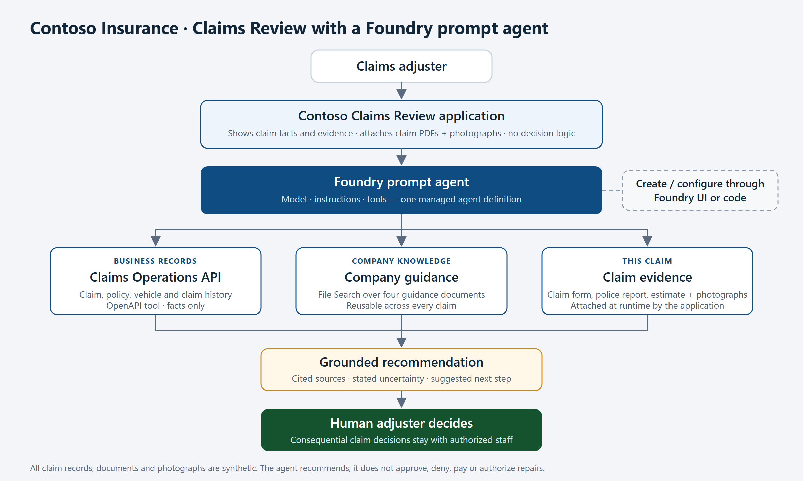

# Contoso Insurance: Claims Processing with a Foundry agent

> **Synthetic demonstration.** Contoso Insurance is fictional. All customers, policies, vehicles,
> claims, documents and photographs here are synthetic; the accident photographs are AI-generated.
> Nothing connects to a real insurer. The agent's output is decision support for a human adjuster,
> not a claim determination.



## What this demo shows

A **Microsoft Foundry prompt agent** that investigates an auto-insurance claim the way an adjuster
would, reconciling sources that never arrive as one clean record:

- **structured claim, policy, vehicle and history records**, from a read-only Claims Operations API (OpenAPI tool)
- **coverage information and company guidance**, from four guidance documents in File Search
- **the claim's own evidence** (claim form, police report, repair estimate and five photographs), attached at runtime

**Hero scenario: claim `CLM-10482`.** Jordan Lee's 2024 Contoso Trailstar was backed into in a parking
lot. Collision coverage applies, with a $1,000 deductible and a $7,850 repair estimate. The agent finds
that the right-rear repairs are supported by the claim form, police report and photographs. It also finds
that one estimate line, a **$1,240 left LED headlamp**, isn't connected to this collision by the current
evidence. It recommends ordinary manual review of that line while the supported repairs continue. It
also says plainly that the evidence **doesn't prove the headlamp was undamaged**.

**Human control.** The agent recommends; it does not approve, deny, authorize repairs, pay or accuse
anyone of fraud. Those decisions stay with the adjuster. The Claims Operations API returns facts only,
and the application contains no claims-decision logic.

**UI or code.** You can create the agent in the Foundry portal ([guide](docs/foundry-ui-agent-setup.md))
or from code ([agent/create_agent.py](agent/create_agent.py)); the definition is the same either way. The
complete multimodal review runs through the **Contoso Claims Review** application ([webapp/](webapp/README.md)),
because a specific claim's PDFs and photographs must be attached at runtime, which the Foundry playground
can't do. The application invokes that same managed agent.

## Presenting the demo

| | |
|---|---|
| Five-minute script with presenter cues | [demo/demo-script.md](demo/demo-script.md) |
| Checklist for 15–30 minutes before | [demo/setup-checklist.md](demo/setup-checklist.md) |
| Live recovery ("one quick fix, then the fallback") | [demo/troubleshooting.md](demo/troubleshooting.md) |
| Fallback transcript (validated previous run) and screenshots | [demo/fallback-transcript.md](demo/fallback-transcript.md), [demo/assets/](demo/assets/) |
| Local and Azure cleanup | [demo/cleanup.md](demo/cleanup.md) |

Validated baseline: agent `contoso-claims-review-agent` **version 3**, model `gpt-6.1-sol`
([demo/baseline.json](demo/baseline.json)). An initial review takes about 42–58 s; follow-ups take about 6–15 s.

## Run path (Windows PowerShell)

Requires Python 3.12+, Node.js 20+ (frontend tests), the Azure CLI and a Foundry project with a model
deployment. On macOS/Linux, use `scripts/setup.sh` and `.venv/bin/python`.

```powershell
cd contoso-claims-processing
$py = ".\.venv\Scripts\python.exe"

# 1. Setup: venv, dependencies and prerequisite checks (copy .env.example to .env first, then az login)
.\scripts\setup.ps1

# 2. Deploy the Claims Operations API and create the agent (once per environment)
& $py scripts\deploy_tools.py --update-env      # Azure Container Apps; writes TOOLS_API_BASE_URL
& $py agent\create_agent.py                     # agent + guidance vector store + OpenAPI tool

# 3. Readiness: ends with exactly CLAIMS DEMO READY or CLAIMS DEMO NOT READY (+ remediation)
& $py scripts\validate_demo.py                  # full (offline suites + Azure checks, no model calls)
& $py scripts\validate_demo.py --quick --live   # quick checks + one live hero review and follow-up

# 4. Start the Claims Review application, then open http://127.0.0.1:8010/
& $py -m uvicorn webapp.backend.app:create_app --factory --port 8010

# 5. Evaluate (live model calls; results are git-ignored)
& $py evaluation\run_evaluation.py --all
& $py scripts\smoke_webapp.py                   # through the application's API

# 6. Reset between presentations (local state only; never touches Azure)
& $py scripts\reset_demo.py
```

`.env`, `agent/config.json`, `.foundry-state.json`, `.deploy/`, `webapp/.logs/` and
`evaluation/results/` are git-ignored. Use `validate_demo.py --offline` for development and CI without
Azure. Cleanup, including optional, deliberate Azure cleanup: [demo/cleanup.md](demo/cleanup.md).

## Repository map

| Folder | Contents |
|---|---|
| [data/](data/README.md) | Deterministic synthetic dataset: 30 customers, 40 policies, 35 vehicles, 50 claims, 12 archived claims, 10 repair facilities |
| [evidence/](evidence/CLM-10482/) | Hero evidence for `CLM-10482` (claim form, police report, repair estimate, 5 photographs, hashed manifest) plus six evaluation claims |
| [tools/](tools/) | Claims Operations API (FastAPI) and its OpenAPI 3.0 contract; Dockerfile |
| [knowledge/](knowledge/README.md) | Four Contoso Insurance guidance documents (Markdown source and PDFs) for File Search |
| [agent/](agent/) | Prompt-agent instructions, creation script and a command-line review runner |
| [webapp/](webapp/README.md) | Contoso Claims Review: adjuster workspace, evidence viewer, agent conversation; observability |
| [evaluation/](evaluation/expected_behaviors.md) | Evaluation cases, runner and scorer |
| [demo/](demo/demo-script.md) | Presenter materials, fallback assets, validated baseline |
| [scripts/](scripts/) | Setup, readiness, reset, deployment and live smoke scripts |
| [tests/](tests/) | Data, evidence, API, knowledge, agent, evaluation, web-app and hygiene tests |

Design and scope: [docs/IMPLEMENTATION-SPEC.md](docs/IMPLEMENTATION-SPEC.md).

Run the command-line review without the application:

```powershell
& $py agent\run_claim_review.py --claim CLM-10482 --follow-up "Show me why you flagged the headlamp."
```
## Regenerating generated files

Every generated file is deterministic and committed. Each generator has a `--check` mode that
verifies the committed files byte-for-byte without writing anything.

| Command | Produces |
|---|---|
| `python data/generate_data.py` | `data/*.json` |
| `python evidence/build_evidence.py` | `evidence/CLM-*/*.pdf`, `evidence-manifest.json` |
| `python evidence/build_evidence.py --import-photos DIR` | also re-imports the source PNGs (matched by SHA-256) as JPEGs |
| `python tools/build_openapi.py` | `tools/openapi.json` |
| `python knowledge/build_pdfs.py` | `knowledge/*.pdf` |

Edit the generator or `evidence/source/` inputs, never the generated files.

## Claims Operations API

A read-only system-of-record API. It returns business facts only: it does not interpret policy
wording, decide coverage, compare or assess evidence, score risk, or recommend claim actions —
that reasoning belongs to the agent.

| Method | Path | operationId |
|---|---|---|
| GET | `/claims/{claimId}` | `get_claim` |
| GET | `/policies/{policyId}` | `get_policy` |
| GET | `/customers/{customerId}/claim-history` | `get_customer_claim_history` |
| GET | `/vehicles/{vehicleId}` | `get_vehicle` |

Failures are returned as HTTP 200 with only an `error` object (`code`, `message`, `httpStatus`,
`retryable`) so an agent can read and explain them. This convention was kept after testing it
against the Foundry OpenAPI tool: a real non-2xx response reaches the agent only as a generic
tool-execution failure, so the agent could not see or explain the cause. Configuration is in [.env.example](.env.example):
`TOOLS_API_PUBLIC_URL` sets the `servers` URL served at `/openapi.json` (Foundry calls OpenAPI tools
from the cloud, so it must be a public HTTPS URL), and `CLAIMS_API_SIMULATE_OUTAGE` simulates an
outage for demos and tests.

## Evidence package

`evidence/CLM-10482/evidence-manifest.json` lists every evidence file with its document ID,
type, source, received time, size and SHA-256 hash. These are the files an adjuster (and later the
agent) reviews.

`evidence/source/` holds the inputs used to render the evidence. In particular, each
`evidence/source/<claim>/photos.json` records how that claim's synthetic photographs were generated
(prompts and provenance). It is build provenance, **not claim evidence**: never upload it to the
agent or a vector store. The agent receives only the files listed in a claim's evidence manifest,
and `agent/common.py` verifies each file against its manifest hash before attaching it.
