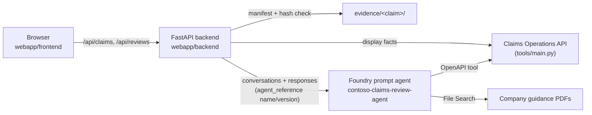

# Contoso Claims Review (Phase 3)

A lightweight claims-adjuster workspace that opens a claim, shows its facts and evidence, and asks the
existing Microsoft Foundry prompt agent **`contoso-claims-review-agent`** to review it. The agent
does the investigation and reasoning; the application presents claim facts, evidence and the agent's
answers, and never draws claim conclusions itself.

> All data, documents and photographs are synthetic. The agent's output is decision support for a
> human adjuster, not a claim determination. The workspace has no approve, deny, payment or
> investigation actions.

## Foundry portal vs. SDK runtime

| Where | What it is used for |
|---|---|
| Foundry portal | Create, configure and inspect the prompt agent: instructions, model, File Search over the company guidance and the Claims Operations API tool ([portal guide](../docs/foundry-ui-agent-setup.md)). Inspect conversations, responses and traces. |
| Code (`agent/create_agent.py`) | Creates the equivalent agent from the same definition. |
| This application (Foundry SDK) | Invokes the **same** Foundry-managed agent and version, attaches the claim-specific PDFs and photographs to the first message, and keeps one Foundry conversation for the follow-ups. |

The Foundry playground is used to configure and inspect the agent, not to run the full multimodal hero
scenario: it cannot attach a specific claim's evidence package to an agent message. The complete review
runs through the SDK/API, here or with `agent/run_claim_review.py`.

## Architecture



### Backend (`webapp/backend/`)

| Module | Responsibility |
|---|---|
| `config.py` | Settings from environment variables (`.env`). Reuses the Phase 2 evidence code in `agent/common.py`. |
| `claims.py` | Display facts for the summary (from the Claims Operations API; in-process when no URL is set) and the evidence catalog from the claim's `evidence-manifest.json`. Serves evidence files by document ID only. |
| `foundry.py` | The Foundry runtime: resolves the agent version, creates the conversation and streams one response per turn. |
| `sessions.py` | One review session = one Foundry conversation. Attaches evidence on the first turn only. |
| `errors.py` | Maps failures to adjuster-facing messages with a reference ID; structured, scrubbed server logs. |
| `app.py` | HTTP routes, static frontend files and security headers. |

HTTP API used by the frontend:

| Method | Path | Purpose |
|---|---|---|
| GET | `/api/about` | Short description of the Foundry portal/SDK split |
| GET | `/api/claims/{claimId}` | Claim summary, policy facts and evidence catalog (display data) |
| GET | `/api/claims/{claimId}/evidence/{documentId}` | One evidence file (`?download=true` to download) |
| GET | `/api/guidance/{guidanceId}` | One company guidance PDF |
| POST | `/api/reviews` | Start a review session for a claim |
| POST | `/api/reviews/{sessionId}/messages` | Send an adjuster message (runs in the background) |
| GET | `/api/reviews/{sessionId}/turns/{turnId}` | Turn status, progress stage and the agent's answer |
| DELETE | `/api/reviews/{sessionId}` | New review: discard the local session |

### Frontend (`webapp/frontend/`)

Plain HTML, CSS and ES modules with no build step and no external resources.

| File | Responsibility |
|---|---|
| `app.js` | Wires the page to the backend API. |
| `lib/views.js` | Pure HTML builders: claim header, summary, policy, evidence panel, conversation, errors. |
| `lib/markdown.js` | Safe Markdown renderer for agent answers. Escapes everything first; emits no links, images, raw HTML or attributes from the answer. |
| `lib/sources.js` | Deterministic citation linking (below). |
| `lib/review.js` | Review controller: one session per review, polling, reset. |

### What the application does not do

The frontend and backend contain no claims logic: no coverage or deductible decisions, no estimate-line
assessment, no evidence comparison, no manual-review, fraud or risk flags, no recommendation selection
and no approval, denial or payment. The agent's answer is shown as written. It is rendered as
Markdown, and its own section headings (`Recommendation`, `Coverage`, `What checks out`,
`Needs review`, `Why`, `Next step`, `Sources`) become cards. If the answer does not use those
headings, it is shown as plain safe text. `tests/test_webapp.py` includes architecture-boundary
checks for these rules.

## Supported evidence path

On the **first** message of a review the backend:

1. loads `evidence/<claim>/evidence-manifest.json`;
2. verifies every listed file's size and SHA-256 hash (`agent/common.py`, the Phase 2 path). If any
   file fails, nothing is sent. The adjuster sees an evidence-validation message, and the server
   log names the file;
3. builds one user message with each PDF as `input_file` and each photograph as `input_image`
   (detail `high`, from `agent/config.json`/`config.example.json`), in manifest order, followed by
   the adjuster's text;
4. creates a Foundry conversation (metadata `claim`, `demo`, `channel=claims-review-webapp`) and
   sends the message with an `agent_reference` to the configured agent name and version.

Follow-up messages are sent as text in the same conversation. The evidence and the earlier tool
results remain in the conversation, so they are **not** resent. Only files listed in the manifest are
ever attached; `evidence/source/` (including `photos.json` generation provenance), evaluation files and
documentation are never sent. Evidence downloads resolve document IDs through the manifest and are
confined to the claim's evidence folder (no client-supplied paths).

## Evidence linking

`lib/sources.js` maps identifiers the agent cites (for example `DOC-10482-08`, ranges such as
`DOC-10482-02 to -06`, and page numbers) to items in the claim's evidence catalog. It also maps the
titles of the company guidance documents. Recognized citations become buttons that open the
evidence. An identifier that is not in the catalog stays plain text. Under each answer, an
**Evidence referenced** list shows the cited items with the agent's own sentences quoted unchanged.
The mapping is used only for navigation and highlighting; it never decides what the evidence means.

## Progress and errors

Progress stages are set only when the backend observes the event: verifying evidence, sending to the
agent, the agent reviewing, checking claim records (an OpenAPI tool call started), consulting company
guidance (a File Search call started), writing the answer. Tool names, IDs and payloads are not shown.

| Situation | Adjuster sees | Recovery |
|---|---|---|
| Evidence hash/size mismatch | Evidence could not be verified; nothing was sent | Fix evidence, new review |
| Missing endpoint, sign-in or agent | Agent is not configured or signed in | Configure, retry |
| Slow or stalled turn (`CLAIMS_REVIEW_TURN_TIMEOUT_SECONDS`) | The review took too long | Start a new review |
| Model/runtime failure, empty or unusable response | Recoverable error with a reference such as `CR-4F2A9C` | Retry |
| Claims Operations API failure during a turn | The agent's own explanation (handled by its instructions) | — |

The reference ID is written in the server log with the specific cause. Endpoints, GUIDs, tokens and
local paths are scrubbed from free-text log fields. A failed first turn leaves no conversation behind,
so a retry starts clean.

## Run it

Prerequisites: the Phase 2 agent exists (`agent/create_agent.py`), the Claims Operations API is
deployed, `.env` is filled in (see `.env.example`) and you are signed in with `az login`.

```powershell
cd contoso-claims-processing
.\.venv\Scripts\python.exe -m uvicorn webapp.backend.app:create_app --factory --port 8010
# open http://127.0.0.1:8010/
```

The workspace and evidence viewer work without Foundry configuration; starting a review then shows a
configuration message.

| Variable | Default | Purpose |
|---|---|---|
| `FOUNDRY_PROJECT_ENDPOINT` | — (required for reviews) | Foundry project endpoint |
| `FOUNDRY_AGENT_NAME` | `contoso-claims-review-agent` | Agent to invoke |
| `FOUNDRY_AGENT_VERSION` | version in `.foundry-state.json`, else latest | Agent version to invoke |
| `CLAIMS_API_BASE_URL` / `TOOLS_API_BASE_URL` | in-process API | Source of the summary's display facts |
| `CLAIMS_REVIEW_DEFAULT_CLAIM` | `CLM-10482` | Claim opened at `/` (any claim: `/?claim=CLM-10471`) |
| `CLAIMS_REVIEW_TURN_TIMEOUT_SECONDS` | `180` | Per-turn limit |
| `CLAIMS_REVIEW_LOG_DIR` | `webapp/.logs` (git-ignored) | Server log folder |

Review sessions are held in memory in a single process (a demo application). Restarting the server
ends open reviews; their Foundry conversations remain in the project.

## Observability

Each completed turn writes a `review.turn_completed` JSON line to `webapp/.logs/claims-review.log`. It
contains the Foundry `conversationId` and `responseId`, the agent name and version, the Claims
Operations API operations called (with any error code), the guidance files File Search returned, the
attachment counts and token usage. It contains no answer text, prompts or evidence content. Failures write
`review.turn_failed` with the reference ID shown to the adjuster.

To inspect a run in the Foundry portal, open the project's **Agents** page, select
`contoso-claims-review-agent`, and use its **Traces**/conversation views (or **Tracing** under
Observability, when Application Insights is connected). Search for the logged conversation or response
ID to see the conversation, the response, the OpenAPI tool calls, File Search calls and results, and
errors. Conversations created by this application carry metadata `channel=claims-review-webapp`. None of
these identifiers are shown in the workspace.

## Tests

```powershell
.\.venv\Scripts\python.exe -m pytest tests\test_webapp.py   # backend, browser exposure, architecture boundaries
node --test webapp/frontend/tests                             # frontend (Node 20+)
.\.venv\Scripts\python.exe scripts\validate_demo.py --offline # every phase, offline (no Azure)
.\.venv\Scripts\python.exe scripts\validate_demo.py           # demo readiness, including Foundry and the API
.\.venv\Scripts\python.exe scripts\smoke_webapp.py            # live: drives this app's API against Foundry
```

The backend tests use a scripted fake Foundry client; they never call the cloud. `smoke_webapp.py`
runs the hero review (plus the headlamp follow-up in the same conversation) three times and the B11,
B12 and B13 evaluation claims twice each through the application's HTTP API. It scores each turn with
the Phase 2 checks in `evaluation/test_cases.json`. Results are written to
`evaluation/results/webapp-smoke/` (git-ignored).
